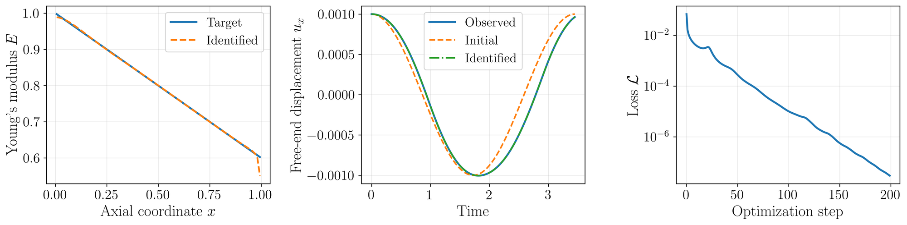
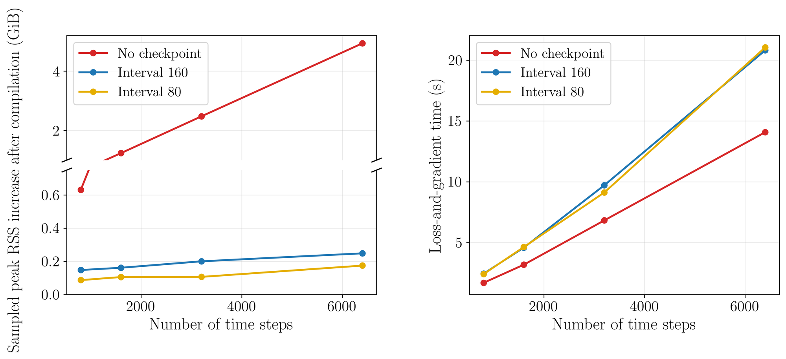
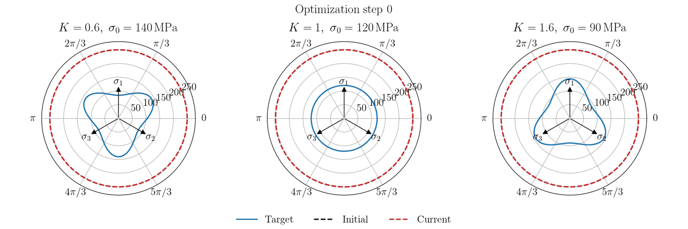

# Differentiable Simulation Tutorials

[](https://www.python.org/) [](https://github.com/jax-ml/jax) [](https://github.com/deepmodeling/jax-fem) [](https://jupyter.org/)

Companion code for the review paper *A Review of Differentiable Programming in Computational Mechanics*. The two notebooks illustrate the two common ways of differentiating a simulation: reverse-mode AD through an explicit time-stepping recurrence, and implicit differentiation of an implicitly defined equilibrium. Both are written in [JAX](https://github.com/jax-ml/jax) and use [JAX-FEM](https://github.com/deepmodeling/jax-fem) as the differentiable finite element solver.

| | Tutorial 1 | Tutorial 2 |
| :--- | :--- | :--- |
| Notebook | [`tutorial_explicit.ipynb`](tutorial_explicit.ipynb) | [`tutorial_implicit.ipynb`](tutorial_implicit.ipynb) |
| Problem | Free vibration of a 3D elastic waveguide | Quasi-static elastoplasticity of a dog-bone specimen |
| Forward solver | Explicit central difference with row-sum mass lumping | Newton–Raphson with a return-mapping constitutive update |
| Discretization | 1,280 `HEX8` elements (2,025 nodes, 6,075 DOF) | 7,900 `TET4` elements (1,706 nodes) |
| Unknowns | 80 layerwise Young's moduli | 4,417 neural-network weights |
| Gradient | Reverse-mode AD through the time-stepping recurrence | Implicit differentiation of the equilibrium equations |
| Verification | Analytical first longitudinal mode | Three parametric yield surfaces |

## Repository layout

```text
tutorial_diffsim/
├── README.md                     # this file
├── requirements.txt              # tutorial dependencies (JAX installed separately)
├── tutorial_explicit.ipynb       # Tutorial 1: explicit differentiation + checkpointing
├── tutorial_implicit.ipynb       # Tutorial 2: implicit differentiation of neural elastoplasticity
└── assets/                       # figures embedded in this README
```

## Installation

```bash
git clone https://github.com/xwpken/tutorial_diffsim.git
cd tutorial_diffsim

conda create -n jax-fem-env python=3.11 -y
conda activate jax-fem-env

# JAX first, matching your hardware: "jax[cpu]" or "jax[cuda12]"
pip install --upgrade "jax[cpu]"

pip install -r requirements.txt
jupyter lab tutorial_explicit.ipynb
```

JAX is deliberately not pinned in [`requirements.txt`](requirements.txt), so that the hardware-specific wheel is not overwritten; see the [official installation guide](https://github.com/jax-ml/jax#installation) for other accelerators. The results below were produced with Python 3.13.13, [JAX](https://github.com/jax-ml/jax) 0.11.0, [JAX-FEM](https://github.com/deepmodeling/jax-fem) 0.0.12, [`optax`](https://github.com/google-deepmind/optax) 0.2.8, [`optimistix`](https://docs.kidger.site/optimistix/) 0.1.0, [`pyvista`](https://github.com/pyvista/pyvista) 0.48.4 and [`matplotlib`](https://matplotlib.org) 3.10.9. Tutorial 1 introduces the [JAX-FEM](https://github.com/deepmodeling/jax-fem) `Problem` interface and the [`jax.lax.scan`](https://docs.jax.dev/en/latest/_autosummary/jax.lax.scan.html) time loop, so it is best run first.

## Tutorial 1 — Explicit differentiation of transient elastodynamics

[`tutorial_explicit.ipynb`](tutorial_explicit.ipynb) identifies the axially varying Young's modulus of a three-dimensional elastic waveguide from transient displacement observations. The forward problem is a lumped-mass finite element discretization advanced by the explicit central-difference method inside [`jax.lax.scan`](https://docs.jax.dev/en/latest/_autosummary/jax.lax.scan.html), with one modulus parameter per axial element layer and synthetic probes at the centerline of every free cross-section. The exact first longitudinal mode provides the verification in Figure 1, and Figure 2 shows the identified field, which reaches a final loss of $3.0 \times 10^{-8}$ and a relative error below $1\%$. Gradients are obtained by reverse-mode AD through the time integrator, and the last section benchmarks [`jax.checkpoint`](https://docs.jax.dev/en/latest/_autosummary/jax.checkpoint.html): over the 12,800-step trajectory used in the paper, the sampled peak process RSS falls from 10.79 GiB without checkpointing to 1.67 GiB with an interval of 800 steps, paid for by recomputation.

<p align="center">
  
  <br>
  <sub>Identified layerwise modulus field, displacement histories, and loss convergence over 200 MoMo-Adam iterations.</sub>
</p>

<p align="center">
  
  <br>
  <sub>Checkpointing trade-off: sampled peak process RSS increase and loss-and-gradient time versus the trajectory length.</sub>
</p>

## Tutorial 2 — Implicit differentiation of neural elastoplasticity

[`tutorial_implicit.ipynb`](tutorial_implicit.ipynb) discovers a neural yield function from kinematic observations, following Gavris and Sun, [PNAS 2025](https://doi.org/10.1073/pnas.2508732122), with the forward evaluation recast in the finite element setting. The specimen is a dog-bone discretized with 7,900 tetrahedra, and the forward problem is a quasi-static, small-strain elastoplastic boundary-value problem without hardening, solved by Newton–Raphson with a return-mapping update at each quadrature point. The yield function is a small multilayer perceptron wrapped with [`jax_fem.solver.ad_wrapper`](https://deepmodeling.github.io/jax-fem/more/api/api_solver.html), so the loss gradient comes from implicit differentiation of the converged equilibrium equations rather than from differentiating through the solver iterations. Starting from a circular $J_2$ surface of radius 250 MPa, MoMo-Adam recovers all three target surfaces from noise-free synthetic data under tension, compression and simple shear.


<p align="center">
  
  <br>
  <sub>Optimization history of the three yield surfaces.</sub>
</p>

## Citation

If you find this repository useful, please cite the review paper:

```bibtex
To be added
```
