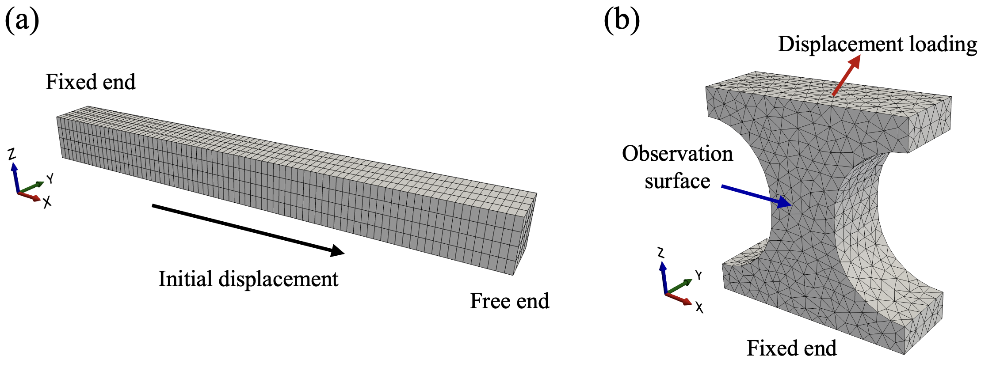
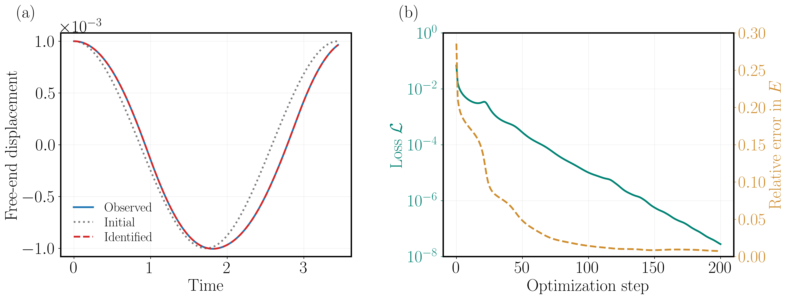
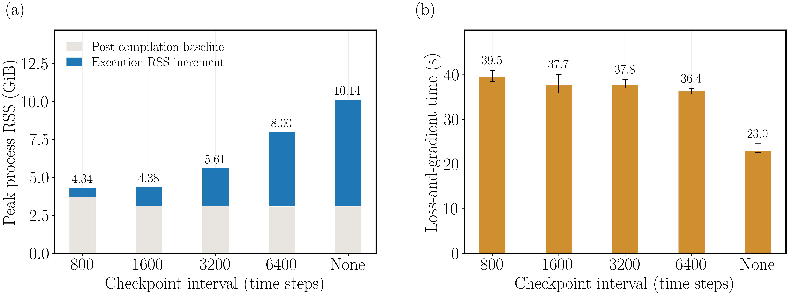
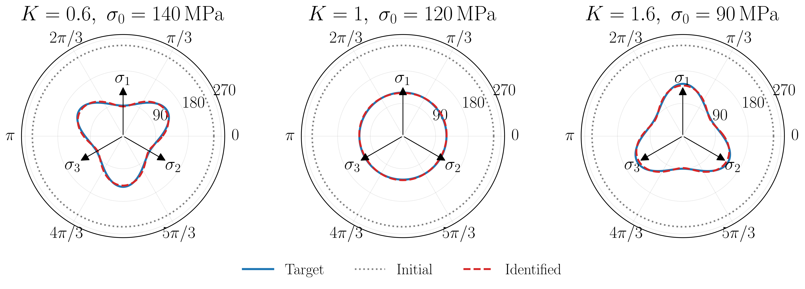

# Differentiable Simulation Tutorials

[](https://www.python.org/) [](https://github.com/jax-ml/jax) [](https://github.com/deepmodeling/jax-fem) [](https://jupyter.org/)

Companion code for the review paper *A Review of Differentiable Programming in Computational Mechanics*. The two notebooks illustrate the two common ways of differentiating a simulation: reverse-mode AD through an explicit time-stepping recurrence, and implicit differentiation of an implicitly defined equilibrium. Both are written in [JAX](https://github.com/jax-ml/jax) and use [JAX-FEM](https://github.com/deepmodeling/jax-fem) as the differentiable finite element solver.

| | Tutorial 1 | Tutorial 2 |
| :--- | :--- | :--- |
| Notebook | [`tutorial_explicit.ipynb`](tutorial_explicit.ipynb) | [`tutorial_implicit.ipynb`](tutorial_implicit.ipynb) |
| Problem | Free vibration of a 3D elastic waveguide | Quasi-static elastoplasticity of a dog-bone specimen |
| Forward solver | Explicit central difference with row-sum mass lumping | Newton–Raphson with a return-mapping constitutive update |
| Discretization | 1,280 `HEX8` elements (2,025 nodes, 6,075 DOF) | 7,900 `TET4` elements (1,706 nodes) |
| Unknowns | 80 layerwise Young's moduli | 4,417 neural-network weights and biases |
| Gradient | Explicit differentiation through the time-stepping recurrence | Implicit differentiation of the equilibrium equations |
| Verification | Analytical first longitudinal mode | Three parametric yield surfaces |


## Repository layout

```text
tutorial_diffsim/
├── README.md                     # this file
├── assets/                       # figures displayed in this README
├── requirements.txt              # additional tutorial dependencies
├── tutorial_explicit.ipynb       # Tutorial 1: explicit differentiation + checkpointing
├── tutorial_implicit.ipynb       # Tutorial 2: implicit differentiation of neural elastoplasticity
└── data/
    ├── input/                    # mesh used by Tutorial 2
    └── output/                   # figures, cached results, and benchmark data
```

## Installation

First follow the [JAX-FEM installation instructions](https://github.com/deepmodeling/jax-fem), including its [JAX](https://github.com/google/jax) setup. Then clone this repository and install the additional tutorial dependencies in the same environment:

```bash
git clone https://github.com/xwpken/tutorial_diffsim.git
cd tutorial_diffsim

conda activate jax-fem-env  # replace with your JAX-FEM environment name

pip install -r requirements.txt
jupyter lab tutorial_explicit.ipynb
```

## Tutorial examples

The following examples illustrate explicit differentiation through transient dynamics and implicit differentiation of nonlinear equilibrium. Their geometries and boundary conditions are shown below.

<p align="center">
  
  <br>
  <sub>Domains and boundary conditions: (a) elastic waveguide; (b) dog-bone specimen.</sub>
</p>

### Tutorial 1 — Explicit differentiation of transient elastodynamics

[`tutorial_explicit.ipynb`](tutorial_explicit.ipynb) identifies the axial distribution of Young's modulus in a 3D elastic waveguide from transient displacement observations. Reverse-mode AD differentiates through explicit time integration, and a checkpointing comparison illustrates the memory–runtime trade-off.

<p align="center">
  
  <br>
  <sub>Free-end displacement histories and identification convergence.</sub>
</p>

<p align="center">
  
  <br>
  <sub>Memory and runtime versus checkpoint interval.</sub>
</p>

### Tutorial 2 — Implicit differentiation of neural elastoplasticity

[`tutorial_implicit.ipynb`](tutorial_implicit.ipynb) identifies a neural yield function from displacement observations of a dog-bone specimen under tension, compression, and shear. Gradients are obtained by implicitly differentiating the equilibrium equations. The example adapts the setup of [Gavris and Sun (2025)](https://doi.org/10.1073/pnas.2508732122) to a finite element formulation.

<p align="center">
  
  <br>
  <sub>Target, initial and identified yield surfaces for the three cases.</sub>
</p>

## Citation

If you find this repository useful, please cite the review paper:

```bibtex
To be added
```
